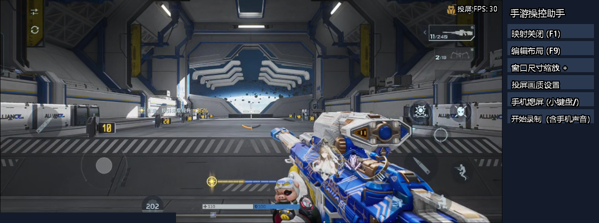
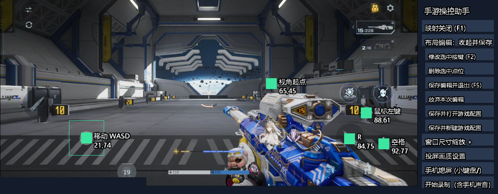
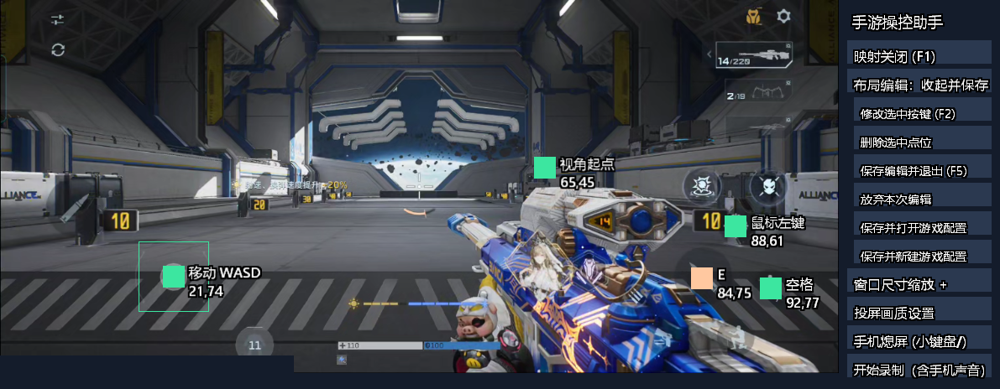
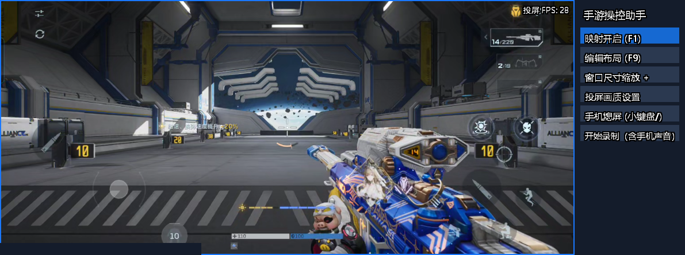

<!-- Modified for MobilePlayHelper; changes from the upstream scrcpy version. -->
# Mobile Play Helper · 手游操控助手

**在 Windows 上看手机画面，用键鼠操控手游，也让 Agent 通过 MCP 读取画面和发送真实触摸。**

MobilePlayHelper（MPH）0.3.0 基于 [scrcpy 4.1](https://github.com/Genymobile/scrcpy)，保留其 Android 投屏与控制链路，增加中文工具条、可视化键位编辑、游戏配置、画质设置、录制诊断和 MCP 接口。当前面向 Windows x64 与已开启 USB 调试的 Android 设备。

[下载发行版](https://github.com/harreke/mobile-play-helper/releases) · [MCP 接入](doc/mcp.md) · [隐私说明](doc/privacy.md) · [第三方声明](THIRD_PARTY_NOTICES.md)



## 可以做什么

| 功能 | 使用方式 |
|---|---|
| 手机投屏与普通控制 | 通过 ADB 连接已授权手机，在电脑上显示画面并用鼠标操作 |
| 键鼠触屏映射 | WASD 驱动虚拟摇杆，鼠标移动拖动视角，按键按下/松开对应落指/抬指 |
| 可视化布局编辑 | 在游戏画面上新增点位、拖动位置、改键、删除，调整摇杆范围和视角灵敏度 |
| 按游戏保存配置 | 保存/打开独立 `.mph` 文件，使用相对坐标适应投屏大小变化 |
| 窗口与手机屏幕控制 | 缩放窗口、适配显示器、请求关闭手机实体屏幕并继续投屏 |
| 手动画质设置 | 调整分辨率、帧率上限、码率和编码格式，应用后重新连接 |
| 录制与诊断 | 录制手机音视频，保存输入事件与诊断数据，方便排查卡顿和触摸问题 |
| MCP 画面与布局工具 | Agent 读取实时状态和截图，创建独立配置、编辑键位及切换映射 |
| MCP 真实触摸 | Agent 发送单指点击、长按、滑动并随时请求中止；随后用截图确认结果 |

## 下载与启动

1. 在 Releases 下载 `MobilePlayHelper-Windows-x64.exe`，或下载 `MobilePlayHelper-Windows-x64-portable.zip` 并完整解压。普通使用不需要 Python、Java 或 Android Studio。
2. 手机开启开发者选项和 **USB 调试**，用数据线连接电脑，在手机上允许此电脑调试。首次使用建议只连接一台设备。
3. 双击下载的单文件 EXE，或便携目录根部的 `MobilePlayHelper.exe`。程序启动 ADB 并尝试连接设备，默认进入**普通模式**。
4. 手机上进入游戏。先到靶场或练习场调整键位，然后按下文开启映射。

便携目录中的 `dist/` 必须完整保留。单文件版会把运行文件释放到本地应用数据目录，位置及第三方库替换方法见 [Windows 发行包说明](doc/windows-distribution.md)。源码仓库不包含运行用 EXE 和 DLL。

## 从布局编辑到开启映射

以下图片来自已连接的 Android 真机，在《逆战：未来》靶场通过 MPH 的 MCP 接口采集，包含真实游戏画面和工具条。页脚账号标识区域已遮挡。示例坐标仅适用于拍摄时的设备与游戏布局，不是通用预设。

### 1. 进入编辑，把点位放到游戏按钮上

普通模式下按 **F9**，或点击工具条“编辑布局”。移动区域对准游戏摇杆，视角起点放在可以拖动视角的空白处。拖动普通点位，使它们与游戏按钮重合。



编辑时的点击只用于修改布局，不会发送到手机。选中移动/视角区域后，F3/F4 调整范围；F7/F8 调整视角灵敏度。标签下方是位置百分比，例如 `84,75` 表示画面宽度约 84%、高度约 75%。

### 2. 新增、修改或删除按键

- **新增：**点击画面空白处，再按目标键盘键或鼠标按钮。
- **改键：**选中已有点位，按 **F2** 或点击“修改选中按键”，再按新键。
- **移动：**直接拖动点位到需要的位置。
- **删除：**选中普通点位，点击“删除选中点位”。

下面展示把原来的 `R` 点位改为 `E`；橙色方块表示当前选中点位。这里演示的是键位配置变更，不表示每款游戏中 E 都对应相同动作。



### 3. 保存布局，按 F1 开启映射

按 **F5** 或点击“保存编辑并退出”，回到普通模式，再短按 **F1**。工具条显示“映射开启”，画面边框变蓝，即可使用键鼠映射。首次进入游戏、切换配置和重连都不会自动开启映射。



映射时鼠标被捕获：短按 F1 关闭映射；按住 F1 可临时释放鼠标，松开后恢复。失焦或最小化会释放触点并暂停，恢复前需松开仍按住的按键/鼠标按钮。橙色边框表示暂停。

### 4. 为不同游戏保留配置

在编辑工具条中选择“保存并新建游戏配置”，输入游戏名；“保存并打开游戏配置”用于切换已有文件。手动界面支持中文文件名。未保存时可选择“放弃本次编辑”。个人 `profiles/` 不随源码发布；内置 [FPS 模板](assets/default-fps.mph) 仅供起步，必须根据游戏实际布局校准。

## 常用快捷键

| 按键 | 操作 |
|---|---|
| F1 | 开关映射；开启后按住可临时使用鼠标 |
| F9 / F5 | 进入编辑 / 保存退出 |
| F2 | 修改选中点位的按键 |
| F3 / F4 | 减小 / 增大选中移动或视角区域 |
| F7 / F8 | 降低 / 提高鼠标视角灵敏度 |
| 小键盘 + / - / * | 放大 / 缩小 / 适配窗口 |
| 小键盘 / | 请求手机熄屏 / 点亮，继续投屏 |
| Num Lock | 映射模式下显示 / 隐藏触点诊断箭头 |
| 键盘左上角 · / ~ | 映射模式下重新落下视角触点 |

F1–F12、Num Lock、上述小键盘运算键和视角刷新键保留给工具。Esc 在映射模式优先执行自定义点位，未绑定时发送 Android 返回。配置语法和触点上限见 [配置格式](doc/mapping-format.md)。

## 让 Agent 通过 MCP 操作

MCP 服务采用本地 stdio，由 Python 启动独立 MPH 客户端。使用便携 ZIP 并安装 **Python 3.12+**，把以下配置中的路径改成自己的解压目录，加入支持 MCP 的 Agent 客户端：

```json
{
  "mcpServers": {
    "mobile-play-helper": {
      "command": "python",
      "args": ["D:/MobilePlayHelper/scripts/mcp_server.py", "--root", "D:/MobilePlayHelper"]
    }
  }
}
```

工具覆盖启动/停止、状态、截图、配置、键位、摇杆/视角区域、映射开关，以及 `mph_tap`、`mph_swipe`、`mph_cancel`。Agent 可以按 **截图 → 判断 → 触摸 → 再截图确认** 的顺序执行简单流程，例如进入菜单或操作指定按钮。坐标范围为 0 到 1，以手机画面为准，不包含右侧工具条。

```text
mph_start   {"profile":"training"}
mph_screenshot {}
mph_tap     {"x":0.5,"y":0.5,"duration_ms":100}
mph_swipe   {"x":0.2,"y":0.75,"to_x":0.2,"to_y":0.6,"duration_ms":500}
mph_cancel  {}
mph_stop    {}
```

示例坐标不对应通用游戏动作，调用前先查看截图。远程触摸只在普通模式可用，单次持续 50–5000 毫秒，当前为**单指**。键鼠映射自身的多触点能力与 MCP 单指接口是不同功能。MCP 不包含现成的挂机领奖、收菜识别或无限循环脚本；这类流程需要 Agent 另行判断游戏状态和停止条件。

本次在《逆战：未来》靶场验证了 MCP 截图、改键、映射开关、真实射击/移动和长按中止。工具成功表示触摸进入发送队列，不代表游戏已执行；请查看后续截图。完整参数、隐私和接入说明见 [MCP 文档](doc/mcp.md)。

## 画质、录制与诊断

工具条可手动设置投屏画质；右上角的“投屏 FPS”统计电脑收到并消费的视频帧，不等于游戏引擎 FPS。**自动画质压力测试目前停用**，不作为可用功能或性能承诺。

录制入口保存手机音视频及输入诊断，详见 [录制说明](doc/recording-diagnostics.md)。常规运行还会产生本地日志和内存诊断，详见 [内存诊断](doc/memory-diagnostics.md) 与 [隐私说明](doc/privacy.md)。分享前请检查设备标识、游戏账号和画面内容。MCP 截图会返回给所连接的 Agent，是否上传云端取决于该客户端。

## 从源码构建

需要 Windows x64、Python 3.12+，以及官方 scrcpy 4.1 Windows x64 完整运行目录：

```powershell
python scripts/build_windows.py --runtime-dir D:/scrcpy
python scripts/test_windows.py
python scripts/test_mcp.py
python scripts/package_windows.py
```

构建脚本下载固定版本工具和头文件并检查 SHA-256；运行依赖复用官方 DLL、ADB 与未修改的 `scrcpy-server`。发布时同时分发 EXE、便携 ZIP、第三方源码 ZIP、校验文件和清单，具体见 [发行包说明](doc/windows-distribution.md) 与 [第三方构建来源](doc/third-party-build.md)。

`app/` 为电脑端；`server/` 为 Android 配套程序源码；`scripts/` 为构建、测试和 MCP 工具；`assets/` 为模板和教程图。Gradle 文件用于重新构建手机端，日常使用及本次电脑端构建不需要 Gradle。架构见 [开发文档](doc/mobileplayhelper-architecture.md)，上游介绍保留在 [README.scrcpy.md](README.scrcpy.md)。

## 兼容性与开源声明

当前编辑及映射要求客户端显示方向为 0，请先在手机上切换到所需方向。不同游戏的输入规则、DPI、灵敏度和布局需要分别调试；短时靶场验证不代表长期稳定性、全部游戏兼容或 60 FPS 性能验证。断线或强制结束进程时，不能保证最后的抬指消息送达。

本项目是 scrcpy 的独立衍生项目，与 Genymobile 或示例游戏的开发商、发行商无隶属或背书关系。保留上游版权与 Apache-2.0 许可证，MPH 原创新增代码同样使用 Apache-2.0，详见 [LICENSE](LICENSE)、[NOTICE](NOTICE) 和 [第三方声明](THIRD_PARTY_NOTICES.md)。FFmpeg、libusb 等运行组件适用各自许可证，并附相应源码与替换说明。

教程图中的《逆战：未来》游戏画面、名称及美术权利归原权利人所有，用于说明本工具功能，不属于本项目原创代码的 Apache-2.0 授权范围。游戏是否允许键鼠映射及自动化由其服务条款和反作弊规则决定，本项目不承诺免封禁，也不提供绕过反作弊的功能。
