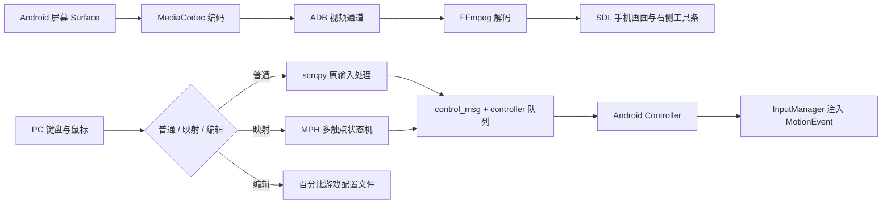

# scrcpy 源码分析与 MPH 实现说明

## 依据与事实校正

本地保留了 scrcpy 完整源码，基于提交 `19c1261d2e2cbf2b5e6a71a8b64cc1dd3ede06ac`（4.1）。scrcpy 原版并非只能点击和 Esc：它已有 SDK 键盘鼠标控制、UHID/AOA、手柄、多指模拟、音频、录制等功能；缺少本需求所需的“游戏布局绑定＋多触点键鼠状态机”。

官方资料：[开发文档](https://github.com/Genymobile/scrcpy/blob/19c1261d2e2cbf2b5e6a71a8b64cc1dd3ede06ac/doc/develop.md)、[控制文档](https://github.com/Genymobile/scrcpy/blob/19c1261d2e2cbf2b5e6a71a8b64cc1dd3ede06ac/doc/control.md)。以下描述来自该版本本地源码，不是对所有 Android 厂商行为的保证。

## 投屏链路

1. PC `app/src/server.c` 与 `app/src/adb/` 选择设备、推送 dex/APK 形式的 `scrcpy-server`，经 ADB 在 shell 权限下使用 `app_process` 启动 Java Server。不要求安装常驻 APK，也不要求 root。
2. `server/.../DesktopConnection.java` 建立视频、音频、控制通道。ADB reverse/forward 提供本地 socket 隧道；USB 和 TCP/IP 共用上层协议。
3. `server/.../video/ScreenCapture.java` 取得显示内容并配置捕获 Surface，`SurfaceEncoder.java` 使用 MediaCodec 编码，`Streamer.java` 发送 codec metadata、包时间戳与编码数据。默认视频 H.264，也有其他编解码选项。旋转/折叠会触发捕获重新配置。
4. PC `demuxer.c` 读取带元数据的包，`decoder.c` 交给 FFmpeg，`frame_buffer.c` / `video_regulator.c` 管理帧，`screen.c` / `texture.c` 用 SDL 显示。它传送压缩视频而非逐帧 PNG 截图，减少 USB 带宽和 CPU 成本。
5. 音频有独立捕获编码、socket、解码和播放线程。MPH 不修改这条链路，不额外叠加一层视频播放器。

## 输入协议为什么能够扩展

`app/src/input_manager.c` 分派 SDL 事件，原版 `mouse_sdk.c`/`keyboard_sdk.c` 生成控制消息。`control_msg.c` 以大端格式序列化，触摸消息包含 action、64 位 pointer ID、画面坐标/宽高、pressure、buttons 等字段。`controller.c` 由独立线程写控制 socket，队列压力大时可以丢弃可丢的移动事件。

Java `control/ControlMessageReader.java` 解析消息，`control/Controller.java::injectTouch()` 校验画面尺寸、转换目标显示坐标并构造 MotionEvent，通过 `wrappers/InputManager.java` 调用隐藏的注入接口。

`control/PointersState.java` 已维护最多 10 个并发指针，会将第二个及以后的 DOWN/UP 转成 Android ACTION_POINTER_DOWN/UP。MPH 因而使用独立的稳定 pointer ID 即可同时移动、转视角、射击，不需要 adb shell input 的单指命令，也不需要修改服务端协议。

## 新增模块与关键选择

- `mph_mapper.c/.h`：独立于 SDL 的输入状态机。0 号逻辑触点移动、1 号视角，其他触点绑定按钮；键盘重复不重复落指；W+A 等归一化；W+S 抵消；按键释放仅释放所属触点。
- `mph_input.c/.h`：SDL 适配、配置校验、可视化编辑、侧栏、切换键、鼠标捕获及控制消息发送。实际 pointer ID 从 `0x4d504800` 起，避免与原版保留的鼠标指针混淆。
- `screen.c`：主窗口不再为工具条预留宽度，恢复完整画面矩形和宽高比锁定；工具条使用独立 SDL 窗口及渲染器，以 Windows owned utility window 绑定主窗口，不可获取键盘焦点。窗口事件先按 windowID 分派，避免工具条的鼠标、尺寸及失焦事件进入手机输入路径。主窗口只渲染手机画面及编辑时的点位标签。高 DPI 下显示坐标使用窗口像素密度，触摸坐标仍根据手机画面归一化。
- `input_manager.c`：MPH 优先处理已消费的游戏/编辑/侧栏事件，其他事件进入上游路径。普通手机控制保留，避免侧栏点击透传。
- `profiles/*.mph`：一个游戏一份配置，0..1 存储相对宽高，编辑界面显示百分比；布局变化需要重新校准，分辨率改变不需要手改像素。
- `app/mph_launcher.c`：原生 Windows EXE 入口，启动 dist 中的 GUI 程序，无 shell 依赖。游戏配置在工具条中通过系统打开/保存对话框选择和创建；底层 scrcpy 参数仍可透传。

鼠标使用 SDL 相对输入，不依赖桌面光标位置。视角在配置区域内累积，越界前发送 UP→中心 DOWN→MOVE；大的位移分步处理，同时限制每事件最多 128 步防止异常输入占用线程。这是持续拖动的近似，极端大位移可能限幅，不代表原生 PC 游戏鼠标输入。

关闭映射或失焦会逐个松手；失败的 UP 保留在状态中，重新开启前再次尝试释放。设备旋转会改变视频尺寸，客户端按新尺寸尝试释放并禁用映射，仍受设备旋转与控制通道时序影响。不能保证断线/强杀时释放送达，不能据此宣称所有游戏都无粘键。

## 验证边界

映射核心测试验证 DOWN/MOVE/UP 时序、触点隔离、对角线半径、反向抵消、连发重复忽略、并发触点上限、事件失败与释放重试。SDL 集成测试使用真实 SDL 渲染器和模拟控制器，验证编辑新增/拖动/改键/删除/保存覆盖/重载/放弃、侧栏快捷键修改、模式切换和失焦释放，不向手机注入游戏操作。

上游回归测试包括控制消息序列化、设备消息解析、ADB 解析、CLI、方向变换、缓冲区和容器测试。真机测试仅验证视频链路与退出。不同游戏的按钮坐标、输入限制、视角重落指行为、长按语义和灵敏度必须按游戏实测，示例模板不能当作已适配游戏清单。
